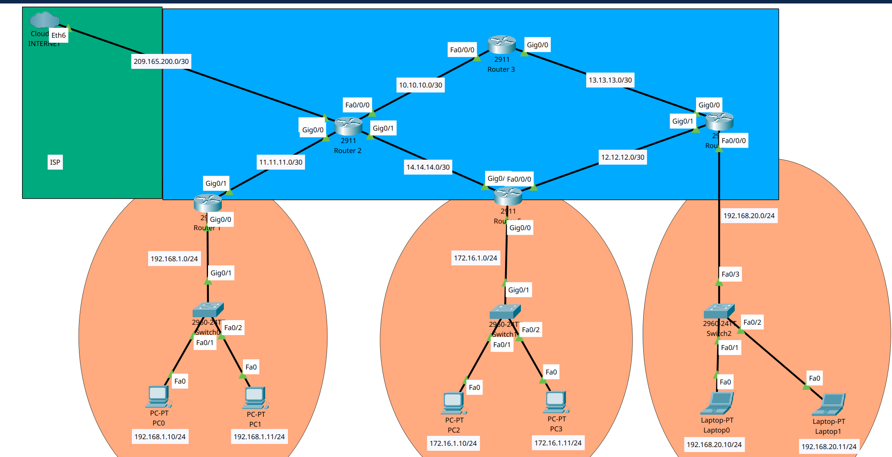

# Lab 01 — Configuração Básica de Dispositivos de Rede (Cisco Packet Tracer)

Este laboratório consiste na configuração inicial de dispositivos de rede (switches L2 e roteadores L3) utilizando o **Cisco Packet Tracer**. Inclui definição de nomes (hostnames), endereçamento IP, senhas de acesso, banner de aviso, criptografia de senhas, acesso remoto restrito e roteamento estático IPv4.

## Estrutura do laboratório

```text
lab01/
├── apk_file/
│   └── lab01.pkt        # Ficheiro da topologia do Cisco Packet Tracer
├── images/
│   └── lab.png          # Imagem da topologia de rede
└── README.md            # Este ficheiro
```

> **Onde está o ficheiro APK/Packet Tracer?**  
> O ficheiro da topologia encontra-se em `apk_file/lab01.pkt`.  
> **Onde está a imagem da topologia?**  
> A imagem encontra-se em `images/lab.png`.

---

## Objetivos

No final deste laboratório todos os dispositivos deverão:

1. Ter um **nome (hostname)** único e um **endereçamento IP** configurado.
2. Ter **senhas de acesso** definidas para o console e para o modo privilegiado.
3.1 Ter um **banner de aviso (MOTD)** e permitir **apenas 3 utilizadores simultâneos via acesso remoto (VTY)**.
3.2 Ter as **senhas encriptadas** (dispositivos L2 e L3).
5. Ter **roteamento estático IPv4** configurado em todos os roteadores.
6. Garantir **conectividade entre todos os clientes** (todos os clientes alcançáveis uns aos outros).

> **Senha padrão de todos os dispositivos:** `class`

---

## Topologia



---

## Configurações detalhadas

A seguir apresentam-se os passos de configuração. Os comandos são apresentados no estilo Cisco IOS e devem ser aplicados em **todos os dispositivos** (routers e switches), salvo indicação em contrário.

### 1. Nome do dispositivo e endereçamento IP

```text
Router> enable
Router# configure terminal
Router(config)# hostname R1
R1(config)# interface GigabitEthernet0/0
R1(config-if)# ip address 192.168.10.1 255.255.255.0
R1(config-if)# no shutdown
R1(config-if)# exit
```

Repita para cada interface e para cada dispositivo, atribuindo nomes e endereços IP coerentes com a topologia.

### 2. Senhas (console e modo privilegiado)

Definir senha de acesso ao console:

```text
R1(config)# line console 0
R1(config-line)# password class
R1(config-line)# login
R1(config-line)# exit
```

Definir senha para o modo privilegiado (enable):

```text
R1(config)# enable secret class
```

> Aplique este procedimento em **todos os dispositivos**.

### 3.1 Banner de aviso e acesso remoto limitado a 3 utilizadores

Configurar banner MOTD (avisando os utilizadores):

```text
R1(config)# banner motd # Autorizado apenas para utilizadores credenciados #
```

Configurar linhas VTY para permitir **no máximo 3 sessões remotas simultâneas** (linhas 0 a 2):

```text
R1(config)# line vty 0 2
R1(config-line)# password class
R1(config-line)# login
R1(config-line)# exit
```

> Nota: as linhas VTY 3, 4 e superiores devem permanecer inativas ou sem senha de modo a respeitar o limite de 3 utilizadores remotos.

### 3.2 Criptografia de senhas (L2 e L3)

Ativar a encriptação de senhas armazenadas no arquivo de configuração:

```text
R1(config)# service password-encryption
```

> Aplique este comando em **todos os switches (L2) e roteadores (L3)**.

---

### 5. Roteamento estático IPv4 (todos os roteadores)

Em cada roteador, adicionar rotas estáticas para as redes remotas. Exemplo:

```text
R1(config)# ip route 192.168.20.0 255.255.255.0 192.168.10.2
R1(config)# ip route 192.168.30.0 255.255.255.0 192.168.10.2
```

Repita em todos os roteadores de modo que cada rede remota tenha uma rota estática apontando para o próximo salto (next-hop) correto.

---

### 6. Conectividade entre todos os clientes

Após aplicar as configurações acima, verificar que **todos os clientes (PCs) conseguem comunicar entre si**, independentemente da rede/sub-rede a que estejam ligados.

Testes de verificação (a partir de cada PC):

```text
PC> ping <IP-do-outro-cliente>
```

Exemplo de comandos de verificação nos roteadores:

```text
R1# show ip route
R1# show ip interface brief
R1# show running-config
```

---

## 🛠️ Como abrir o laboratório

1. Instale o [Cisco Packet Tracer](https://www.netacad.com/).
2. Abra o ficheiro `apk_file/lab01.pkt`.
3. Consulte a imagem da topologia em `images/lab.png` para identificar os nomes dos dispositivos e os endereços IP.

---
